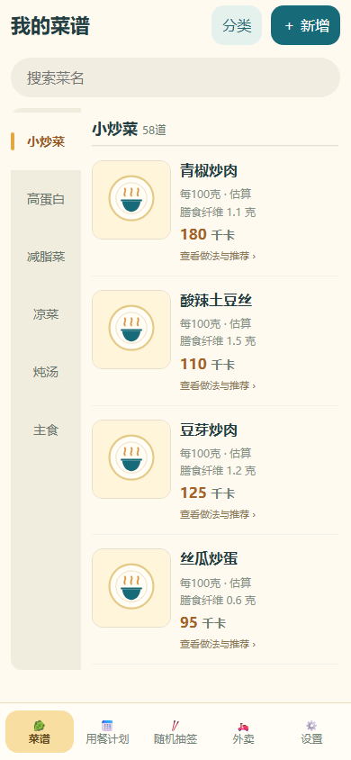
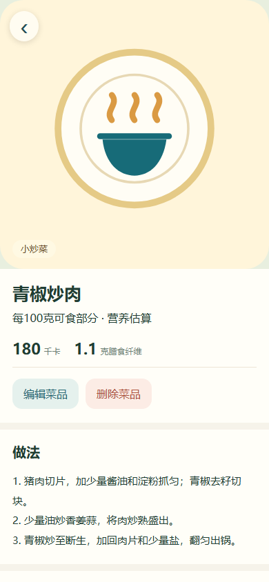

# 美味餐饮 · Meiwei Menu

**一个离线使用的 Android 菜谱与选餐工具：记录喜欢的菜，安排午餐和晚餐，不想决定时抽一道。**

An offline-first Android recipe journal and meal planner, built with Java and native JavaScript modules. No account or server is required. Contributions are welcome.

   

## 应用一览

<p align="center">
  <a href="docs/screenshots/menu.png"></a>
  <a href="docs/screenshots/detail.png"></a>
</p>
<p align="center"><sub>左：分类菜谱与营养估算 ｜ 右：菜品详情与做法步骤</sub></p>

## 功能一览

| 模块 | 能做什么 |
| :--- | :--- |
| 🍳 菜谱 | 分类保存菜品、图片、做法及每100克热量和膳食纤维 |
| 📅 用餐计划 | 按日期安排午晚餐，搜索菜品或店铺，按重量或份数统计已知营养 |
| 🎲 随机抽签 | 在指定分类或外卖记录中随机选择，直接加入某天的计划 |
| 🔍 详情与推荐 | 查看菜品详情和各分类随机推荐，裁剪正方形照片 |
| 💾 备份 | 导出、恢复本机备份；新建记录允许只填名称 |

公开版包含70道家常菜和18条餐厅名称示例，所有预置配图随源码提供，逐图来源与许可见 [图片清单](docs/IMAGE_CREDITS.md)。营养值为粗略估算，配方、用油、馅料和熟制含水量不同都会改变结果。

## 下载

到 [Releases](https://github.com/wang189327-wq/Food-Dice/releases) 下载正式公开版APK。公开版已包含全部预置菜品与餐厅示意图，也可添加自己的菜品照片。当前版本为 **1.0（版本码1）**，原签名保持不变。后续版本递增后可正常覆盖升级。

| 项目 | 说明 |
| :--- | :--- |
| 最低系统 | Android 10 |
| 网络 | 无需服务器，离线使用 |
| 账号 | 无需注册 |
| 数据 | 只保存在本机，支持导出/恢复备份 |

## 在浏览器中试运行

无需安装 APK，即可在浏览器中体验完整功能。需要 Node.js 22+，静态预览可用 Python 3：

```sh
npm ci
npx playwright install chromium
python -m http.server 8080 --directory android/assets
```

打开 `http://localhost:8080`。这是浏览器独立存储，不会读写手机数据。直接双击HTML文件会遇到ES modules的本地文件限制，请使用本地HTTP服务。

测试与质量检查：

```sh
npm test
```

测试覆盖菜单、详情推荐、照片裁剪、计划、外卖、旧数据保留、缺失营养、保存失败回滚，以及无业务全局变量和模块循环依赖。测试专用导入桥只由测试服务器注入，不进入APK。

## 构建

### 开发版（任何人可构建）

需要 Python 3.10+、JDK 17、Android SDK Platform 35 和 Build Tools 35.0.0，设置 `JAVA_HOME`、`ANDROID_HOME`：

```sh
python build-android.py --debug --public-assets
```

开发版使用独立包名 `cn.localmenu.app.debug` 和本机生成的调试密钥，可与正式版共存，不需要维护者私钥。APK位于 `delivery/`。CI同样构建开发版。

### 正式版（仅维护者）

设置 `MENU_SIGN_DIR` 指向含 `menu-release.p12` 与 `password.txt` 的私密目录，再运行 `python build-android.py --public-assets`。密钥永不提交。本项目也兼容历史离线工具目录，可用 `MENU_TOOLCHAIN` 指定。

本地维护者的离线工具和签名可集中存放于 `delivery/离线构建资源/`（不提交Git），构建脚本自动查找。

版本修改集中在 `version.json`。公开正式版检查GitHub上的更新清单，下载后校验SHA-256、包名、版本和证书；安卓仍要求用户确认安装。

## 代码结构

| 路径 | 职责 |
| :--- | :--- |
| `android/src/cn/localmenu/app/` | Android生命周期、存储桥、白名单资源路由和更新安装 |
| `android/assets/js/seed-data.js` | 预置菜谱、餐厅和做法 |
| `store.js` | 唯一的数据写入入口、验证、失败回滚和订阅；保留历史备份格式 |
| `catalog.js` / `catalog-view.js` | 菜单和详情交互 / 显示模板 |
| `planner.js`、`draw.js`、`takeout.js`、`photos.js` | 各自的业务功能 |
| `data.js`、`validation.js` | 公共显示工具和字段校验 |
| `app.js` | 启动、渲染订阅和返回键；不把业务状态挂在 `window` 上 |

详见 [架构说明](docs/architecture.md) 和 [贡献指南](CONTRIBUTING.md)。

## 图片与隐私

仓库包含原创封面/图标、SVG占位图，以及按CC BY、CC BY-SA或CC0许可提供的摄影配图。图片作者、原图页、许可证、裁剪处理与SHA-256见 [完整图片清单](docs/IMAGE_CREDITS.md) 和 [机器可读清单](docs/image-attributions.json)，应用设置也可查看。

餐厅图片为品类示意图，不是指定门店实拍。40道菜因未选到合适照片，从公开预置清单移除，详见 [清单](docs/public-catalog-changes.md)。原个人完整版仍保留110道菜，其源码、原图和私密构建资料不在公开仓库。

新增图片默认被Git忽略；公开配图须补充许可清单和SHA-256，并明确加入Git允许列表。不要提交私人菜谱备份、照片、签名文件或访问凭据。用户数据只保存在当前设备，不做云端同步。

## 项目状态

这是个人项目的首个公开版本，已完成自动化行为测试和APK构建/签名检查，并由维护者在 vivo X100s Pro 手机与华为 MatePad 平板上完成实体机型自测。欢迎提交手机型号、系统版本和可复现步骤，帮助补齐兼容性。

## 许可

代码采用 [MIT](LICENSE) 许可。摄影图片各自遵循来源清单中的许可证，不统一改为MIT；截图含这些图片，按CC BY-SA 4.0提供。第三方依赖遵循各自许可证；见 [素材说明](docs/assets.md)。
