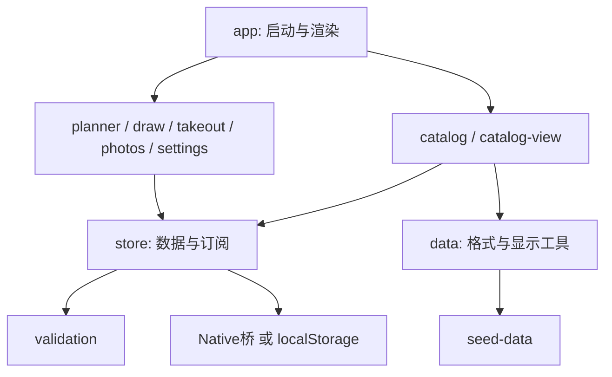
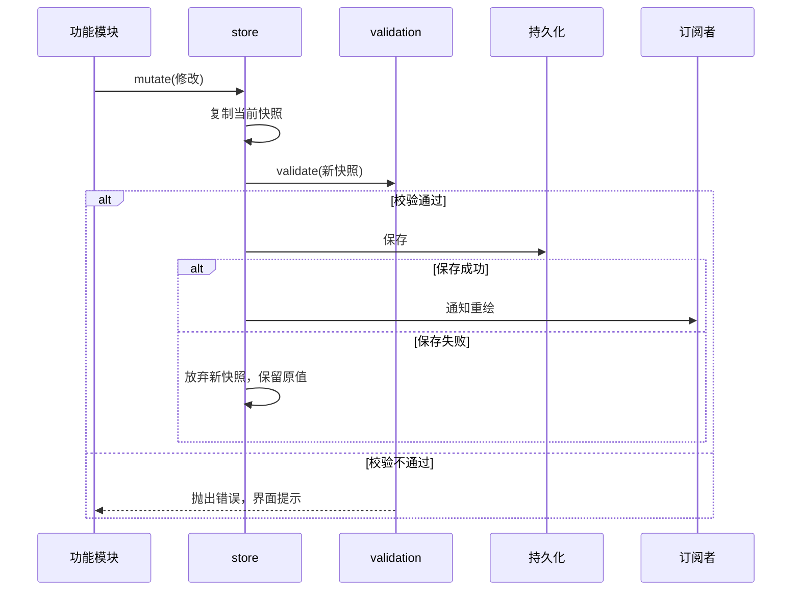
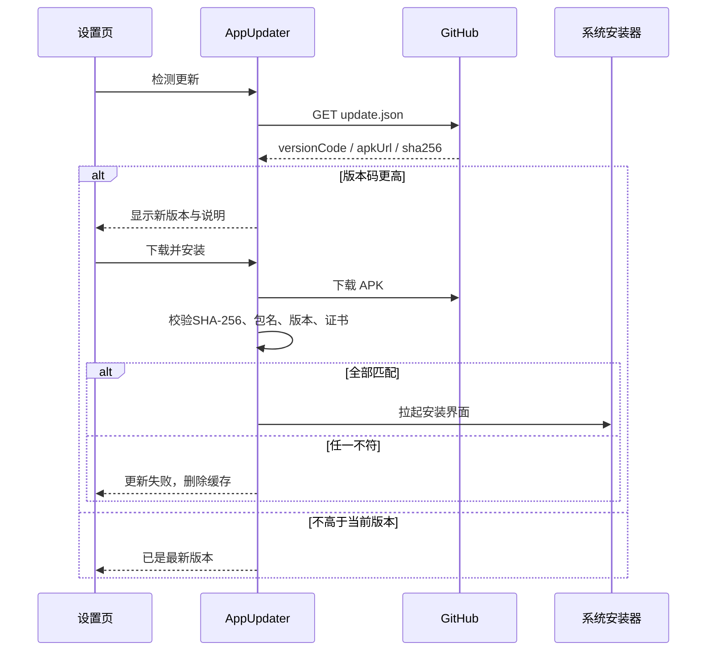

# 架构

UI使用原生ES modules，不依赖框架或打包器。Android通过固定的HTTPS本地源提供打包资源，外部文件路径不会映射到AssetManager。

数据只能经store写入。修改时复制当前快照，校验后保存；保存失败保留原快照，成功后通知订阅者。planner的索引按快照引用失效，避免编辑后使用旧营养值。

详情页面的交互和返回栈在catalog内；catalog-view只生成显示内容。照片编辑状态由photos持有，其他模块通过明确导入的状态对象使用，不散落为全局变量。未导出的状态属于模块私有实现。

历史数据中的schema=1、SharedPreferences文件menu/data以及seedVersion/menu130标记保持兼容。函数ensureStarterCatalog使用历史标记，命名不再绑定某个显示版本。

Android的MainActivity负责生命周期、系统边距、相册和数据桥；LocalWebClient只服务允许的JS、CSS、图片；AppUpdater负责HTTPS更新、最多5次安全重定向、哈希及签名校验和安装缓存清理。

构建从version.json生成Java常量和浏览器版本元数据，每次使用独立临时目录。公开版预置70道菜和18条餐厅记录，所有预置图片由许可清单及哈希验证后打包。个人本地完整版单独封存，仍保留110道菜和原图，不随仓库公开；两版保留相同的核心功能与备份格式。正式包与开发包的包名和签名不同，不会互相覆盖。

图片署名以docs/image-attributions.json为唯一维护入口，scripts/sync-image-credits.py生成asset-credits模块和Markdown清单。settings按需展示署名；原生桥只允许用系统浏览器打开明确列出的HTTPS来源及许可证站点。

version.json中的edition=public使根目录构建默认产出-public包，防止覆盖保留的本地完整包。
